<!--
  Every image has a dark and a light variant; GitHub shows the one that matches
  the visitor's color scheme. Blocks between START/END markers are generated by
  the weekly workflow and are overwritten on every run.
-->

<picture>
  <source media="(prefers-color-scheme: dark)" srcset="./icons/banner-dark.svg" />
  
</picture>

  <picture>
    <source media="(prefers-color-scheme: dark)" srcset="https://readme-typing-svg.demolab.com?font=Plus+Jakarta+Sans&weight=800&size=44&duration=2200&pause=99999&color=E9D5FF&center=true&vCenter=true&repeat=false&width=760&height=70&lines=Ismael+Barrionuevo" />
    
  </picture>
   
  <picture>
    <source media="(prefers-color-scheme: dark)" srcset="https://readme-typing-svg.demolab.com?font=Plus+Jakarta+Sans&weight=600&size=15&duration=1&pause=99999&color=93C5FD&center=true&vCenter=true&repeat=false&width=760&height=26&lines=SYSTEMS+ENGINEER++%C2%B7++MOBILE++%C2%B7++SOFTWARE+ARCHITECTURE++%C2%B7++DEVOPS++%C2%B7++TEST+AUTOMATION" />
    
  </picture>
   
  <picture>
    <source media="(prefers-color-scheme: dark)" srcset="https://readme-typing-svg.demolab.com?font=Plus+Jakarta+Sans&weight=500&size=17&duration=3200&pause=1100&color=A78BFA&center=true&vCenter=true&width=760&height=40&lines=Building+optimal+solutions%2C+one+cup+of+coffee+at+a+time.;Domain+expansion%3A+infrastructure+as+code.;Every+bug+is+a+curse+waiting+to+be+exorcised.;Learn+relentlessly.+Teach+generously." />
    
  </picture>

<!-- GIFS:START -->
<!-- GIFS:END -->

 

## About

Systems Engineer from **Universidad Icesi** in Cali, Colombia. I enjoy designing and building **optimal solutions**, and I have a soft spot for **mobile app development**, **software architecture**, **DevOps culture** and **test automation**.

I'm still in training, and I love challenges that push me toward new horizons of learning. Beyond code, I like anime, exploring new things, walking, meeting people and teaching what I've learned throughout my life, not just during my degree. And coffee. I really enjoy a good cup of coffee. <picture><source media="(prefers-color-scheme: dark)" srcset="./icons/coffee-dark.svg" /></picture>

My dream? Drinking coffee and resting. Yes, coffee again. <picture><source media="(prefers-color-scheme: dark)" srcset="./icons/coffee-dark.svg" /></picture><picture><source media="(prefers-color-scheme: dark)" srcset="./icons/coffee-dark.svg" /></picture>

<table>
  <tr>
    <td><b>Focus</b></td>
    <td>Mobile development · Software architecture · DevOps · Test automation</td>
  </tr>
  <tr>
    <td><b>Currently</b></td>
    <td>In training, chasing challenges that open new horizons</td>
  </tr>
  <tr>
    <td><b>Off the keyboard</b></td>
    <td>Anime · Walking · Meeting people · Teaching · Exploring</td>
  </tr>
  <tr>
    <td><b>Fuel</b></td>
    <td><picture><source media="(prefers-color-scheme: dark)" srcset="./icons/coffee-dark.svg" /></picture> Coffee, always coffee <picture><source media="(prefers-color-scheme: dark)" srcset="./icons/coffee-dark.svg" /></picture></td>
  </tr>
</table>

<picture><source media="(prefers-color-scheme: dark)" srcset="./icons/coffee-dark.svg" /></picture>

## Education

<picture>
  <source media="(prefers-color-scheme: dark)" srcset="./icons/icic_white.svg" />
  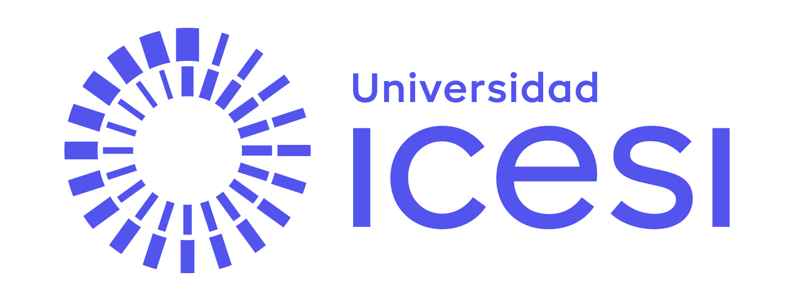
</picture>

**Systems Engineering** 
Universidad Icesi · Cali, Colombia

 

## Cursed techniques

Languages across every repository I've worked on, recalculated every week.

<!-- LANGS:START -->

  <picture>
    <source media="(prefers-color-scheme: dark)" srcset="./icons/languages-dark.svg" />
    
  </picture>

  <picture><source media="(prefers-color-scheme: dark)" srcset="./icons/langs/java-dark.svg" /></picture>
  <picture><source media="(prefers-color-scheme: dark)" srcset="./icons/langs/html-dark.svg" /></picture>
  <picture><source media="(prefers-color-scheme: dark)" srcset="./icons/langs/typescript-dark.svg" /></picture>
  <picture><source media="(prefers-color-scheme: dark)" srcset="./icons/langs/python-dark.svg" />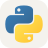</picture>
  <picture><source media="(prefers-color-scheme: dark)" srcset="./icons/langs/jupyter-notebook-dark.svg" />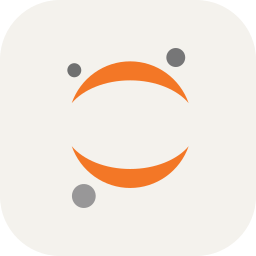</picture>
  <picture><source media="(prefers-color-scheme: dark)" srcset="./icons/langs/javascript-dark.svg" /></picture>
  <picture><source media="(prefers-color-scheme: dark)" srcset="./icons/langs/tex-dark.svg" /></picture>
  <picture><source media="(prefers-color-scheme: dark)" srcset="./icons/langs/kotlin-dark.svg" /></picture>
  <picture><source media="(prefers-color-scheme: dark)" srcset="./icons/langs/shell-dark.svg" /></picture>
  <picture><source media="(prefers-color-scheme: dark)" srcset="./icons/langs/css-dark.svg" /></picture>
  <picture><source media="(prefers-color-scheme: dark)" srcset="./icons/langs/dockerfile-dark.svg" /></picture>
  <picture><source media="(prefers-color-scheme: dark)" srcset="./icons/langs/groovy-dark.svg" />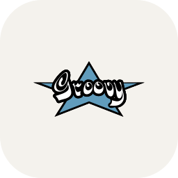</picture>
  <picture><source media="(prefers-color-scheme: dark)" srcset="./icons/langs/blade-dark.svg" />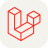</picture>
  <picture><source media="(prefers-color-scheme: dark)" srcset="./icons/langs/php-dark.svg" /></picture>

<!-- LANGS:END -->

## Arsenal

<!-- TOOLS:START -->
<table align="center">
  <tr>
    <td align="right"><b>Mobile</b></td>
    <td><picture><source media="(prefers-color-scheme: dark)" srcset="./icons/tools/flutter-dark.svg" /></picture> <picture><source media="(prefers-color-scheme: dark)" srcset="./icons/tools/dart-dark.svg" /></picture> <picture><source media="(prefers-color-scheme: dark)" srcset="./icons/tools/kotlin-dark.svg" /></picture> <picture><source media="(prefers-color-scheme: dark)" srcset="./icons/tools/android-studio-dark.svg" /></picture> <picture><source media="(prefers-color-scheme: dark)" srcset="./icons/tools/android-dark.svg" />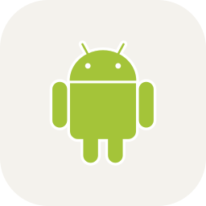</picture> <picture><source media="(prefers-color-scheme: dark)" srcset="./icons/tools/ios-dark.svg" />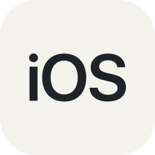</picture></td>
  </tr>
  <tr>
    <td align="right"><b>Frameworks</b></td>
    <td><picture><source media="(prefers-color-scheme: dark)" srcset="./icons/tools/next-js-dark.svg" /></picture> <picture><source media="(prefers-color-scheme: dark)" srcset="./icons/tools/nestjs-dark.svg" /></picture> <picture><source media="(prefers-color-scheme: dark)" srcset="./icons/tools/spring-boot-dark.svg" /></picture> <picture><source media="(prefers-color-scheme: dark)" srcset="./icons/tools/django-dark.svg" /></picture></td>
  </tr>
  <tr>
    <td align="right"><b>Libraries &amp; Runtimes</b></td>
    <td><picture><source media="(prefers-color-scheme: dark)" srcset="./icons/tools/react-dark.svg" /></picture> <picture><source media="(prefers-color-scheme: dark)" srcset="./icons/tools/node-js-dark.svg" /></picture></td>
  </tr>
  <tr>
    <td align="right"><b>Architecture &amp; Modeling</b></td>
    <td><picture><source media="(prefers-color-scheme: dark)" srcset="./icons/tools/clean-architecture-dark.svg" />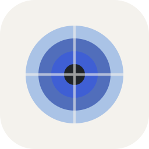</picture> <picture><source media="(prefers-color-scheme: dark)" srcset="./icons/tools/uml-dark.svg" />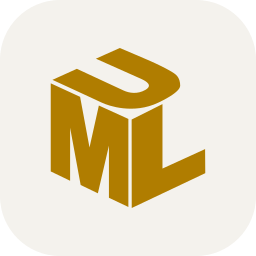</picture> <picture><source media="(prefers-color-scheme: dark)" srcset="./icons/tools/visual-paradigm-dark.svg" />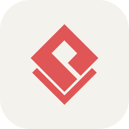</picture></td>
  </tr>
  <tr>
    <td align="right"><b>Networking</b></td>
    <td><picture><source media="(prefers-color-scheme: dark)" srcset="./icons/tools/ssh-dark.svg" />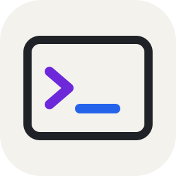</picture> <picture><source media="(prefers-color-scheme: dark)" srcset="./icons/tools/tunneling-dark.svg" />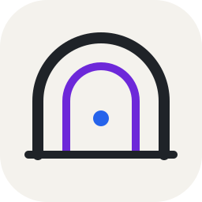</picture> <picture><source media="(prefers-color-scheme: dark)" srcset="./icons/tools/tcp-dark.svg" />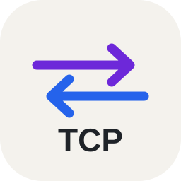</picture> <picture><source media="(prefers-color-scheme: dark)" srcset="./icons/tools/udp-dark.svg" /></picture></td>
  </tr>
  <tr>
    <td align="right"><b>Cloud</b></td>
    <td><picture><source media="(prefers-color-scheme: dark)" srcset="./icons/tools/aws-dark.svg" /></picture> <picture><source media="(prefers-color-scheme: dark)" srcset="./icons/tools/google-cloud-dark.svg" /></picture> <picture><source media="(prefers-color-scheme: dark)" srcset="./icons/tools/cloudflare-dark.svg" /></picture></td>
  </tr>
  <tr>
    <td align="right"><b>Containers &amp; CI/CD</b></td>
    <td><picture><source media="(prefers-color-scheme: dark)" srcset="./icons/tools/docker-dark.svg" /></picture> <picture><source media="(prefers-color-scheme: dark)" srcset="./icons/tools/kubernetes-dark.svg" /></picture> <picture><source media="(prefers-color-scheme: dark)" srcset="./icons/tools/terraform-dark.svg" /></picture> <picture><source media="(prefers-color-scheme: dark)" srcset="./icons/tools/jenkins-dark.svg" /></picture> <picture><source media="(prefers-color-scheme: dark)" srcset="./icons/tools/github-actions-dark.svg" /></picture></td>
  </tr>
  <tr>
    <td align="right"><b>OS &amp; Shell</b></td>
    <td><picture><source media="(prefers-color-scheme: dark)" srcset="./icons/tools/linux-dark.svg" /></picture> <picture><source media="(prefers-color-scheme: dark)" srcset="./icons/tools/windows-dark.svg" /></picture> <picture><source media="(prefers-color-scheme: dark)" srcset="./icons/tools/bash-dark.svg" /></picture> <picture><source media="(prefers-color-scheme: dark)" srcset="./icons/tools/powershell-dark.svg" /></picture></td>
  </tr>
  <tr>
    <td align="right"><b>Testing &amp; Quality</b></td>
    <td><picture><source media="(prefers-color-scheme: dark)" srcset="./icons/tools/sonarqube-dark.svg" />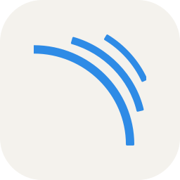</picture> <picture><source media="(prefers-color-scheme: dark)" srcset="./icons/tools/playwright-dark.svg" />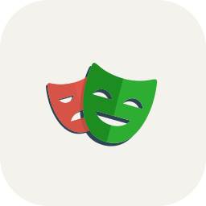</picture> <picture><source media="(prefers-color-scheme: dark)" srcset="./icons/tools/selenium-dark.svg" /></picture> <picture><source media="(prefers-color-scheme: dark)" srcset="./icons/tools/postman-dark.svg" /></picture> <picture><source media="(prefers-color-scheme: dark)" srcset="./icons/tools/newman-dark.svg" />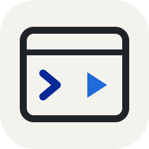</picture></td>
  </tr>
  <tr>
    <td align="right"><b>Security</b></td>
    <td><picture><source media="(prefers-color-scheme: dark)" srcset="./icons/tools/owasp-dark.svg" />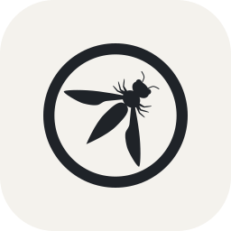</picture> <picture><source media="(prefers-color-scheme: dark)" srcset="./icons/tools/owasp-zap-dark.svg" />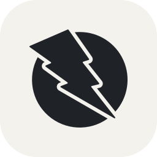</picture> <picture><source media="(prefers-color-scheme: dark)" srcset="./icons/tools/snort-dark.svg" />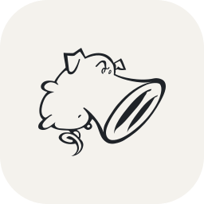</picture> <picture><source media="(prefers-color-scheme: dark)" srcset="./icons/tools/tor-dark.svg" />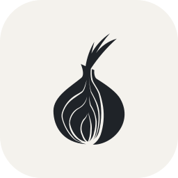</picture></td>
  </tr>
  <tr>
    <td align="right"><b>Data</b></td>
    <td><picture><source media="(prefers-color-scheme: dark)" srcset="./icons/tools/postgresql-dark.svg" /></picture> <picture><source media="(prefers-color-scheme: dark)" srcset="./icons/tools/oracle-dark.svg" /></picture> <picture><source media="(prefers-color-scheme: dark)" srcset="./icons/tools/mongodb-dark.svg" /></picture></td>
  </tr>
  <tr>
    <td align="right"><b>Version Control &amp; Artifacts</b></td>
    <td><picture><source media="(prefers-color-scheme: dark)" srcset="./icons/tools/git-dark.svg" /></picture> <picture><source media="(prefers-color-scheme: dark)" srcset="./icons/tools/github-dark.svg" /></picture> <picture><source media="(prefers-color-scheme: dark)" srcset="./icons/tools/gitlab-dark.svg" /></picture> <picture><source media="(prefers-color-scheme: dark)" srcset="./icons/tools/bitbucket-dark.svg" /></picture> <picture><source media="(prefers-color-scheme: dark)" srcset="./icons/tools/nexus-dark.svg" />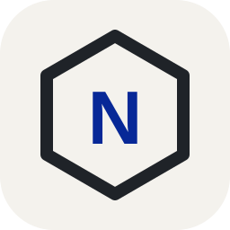</picture></td>
  </tr>
  <tr>
    <td align="right"><b>Productivity</b></td>
    <td><picture><source media="(prefers-color-scheme: dark)" srcset="./icons/tools/jira-dark.svg" /></picture> <picture><source media="(prefers-color-scheme: dark)" srcset="./icons/tools/intellij-idea-dark.svg" /></picture> <picture><source media="(prefers-color-scheme: dark)" srcset="./icons/tools/vs-code-dark.svg" /></picture> <picture><source media="(prefers-color-scheme: dark)" srcset="./icons/tools/google-colab-dark.svg" />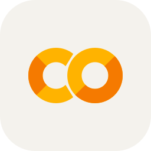</picture></td>
  </tr>
  <tr>
    <td align="right"><b>Exploring</b></td>
    <td><picture><source media="(prefers-color-scheme: dark)" srcset="./icons/tools/scala-dark.svg" /></picture></td>
  </tr>
</table>
<!-- TOOLS:END -->

## Side quests

Not my stack, just things I enjoy. Mostly coffee.

<!-- FUN:START -->

  <picture><source media="(prefers-color-scheme: dark)" srcset="./icons/fun/coffee-dark.svg" /></picture> <picture><source media="(prefers-color-scheme: dark)" srcset="./icons/fun/tails-os-dark.svg" />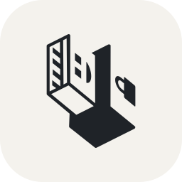</picture> <picture><source media="(prefers-color-scheme: dark)" srcset="./icons/fun/root-mode-dark.svg" />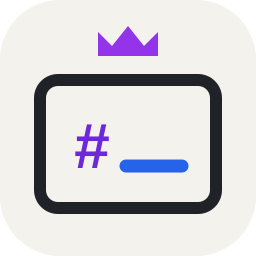</picture> <picture><source media="(prefers-color-scheme: dark)" srcset="./icons/fun/anonymous-dark.svg" />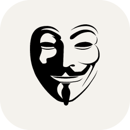</picture> <picture><source media="(prefers-color-scheme: dark)" srcset="./icons/fun/more-coffee-dark.svg" /></picture>

<!-- FUN:END -->

<picture><source media="(prefers-color-scheme: dark)" srcset="./icons/coffee-dark.svg" /></picture>

## Cursed energy

  <picture>
    <source media="(prefers-color-scheme: dark)" srcset="https://streak-stats.demolab.com?user=DavidRamirez206&hide_border=true&border_radius=14&background=0D1117&stroke=30363D&ring=A78BFA&fire=60A5FA&currStreakLabel=C4B5FD&sideLabels=E6EDF3&currStreakNum=FFFFFF&sideNums=FFFFFF&dates=8B949E" />
    
  </picture>

  

  <picture>
    <source media="(prefers-color-scheme: dark)" srcset="./icons/snake-dark.svg" />
    
  </picture>

<picture><source media="(prefers-color-scheme: dark)" srcset="./icons/coffee-dark.svg" /></picture> <picture><source media="(prefers-color-scheme: dark)" srcset="./icons/coffee-dark.svg" /></picture> <picture><source media="(prefers-color-scheme: dark)" srcset="./icons/coffee-dark.svg" /></picture>

Powered by coffee. This profile refreshes itself every week through GitHub Actions. Logos are trademarks of their respective owners. See LICENSE for terms of use.

